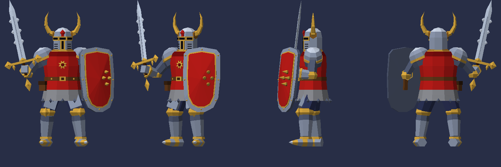

# Лоу-поли рыцарь (PS1)

Рыцарь с мечом и щитом в стиле игр PlayStation 1: рогатый шлем с Т-образной прорезью,
красная котта с солнцем на груди, кольчужная юбка, золотые наколенники и щит с шипами.

- 2 492 треугольника, плоские грани;
- одна текстура-палитра 64×64 (13 цветов, клетка 8×8 на цвет, фильтрация «nearest»);
- рост до макушки шлема около 1,97 единицы (метра), ноги стоят на нуле, лицом к +Z.



## Файлы

| Файл | Что это |
|---|---|
| `knight.glb` | Модель для Blender, Godot, Unity, three.js. Палитра встроена в файл |
| `knight.obj`, `knight.mtl`, `palette.png` | То же самое в формате OBJ |
| `viewer.html` | Просмотрщик в духе PS1: 320×240, дрожание вершин, дизеринг, туман. Открывается в браузере без интернета (шрифты подгружаются, если сеть есть) |
| `build_knight.py` | Генератор модели. Нужен только Python 3.8+ |
| `viewer_template.html` | Шаблон просмотрщика, в него генератор вставляет модель |

## Как поменять модель

Поза, пропорции и детали задаются в `build_knight.py`: функции `build_leg`, `build_arm`,
`build_sword`, `build_shield`, `build_helmet` и `build_knight`. Цвета — в словаре `PALETTE`.
После правок пересоберите:

```bash
python3 build_knight.py
```

Перекрасить готовую модель можно и без скрипта: откройте `palette.png` в любом
редакторе и залейте нужную клетку другим цветом.

## Импорт

- **Blender**: File → Import → glTF 2.0 (`knight.glb`). Чтобы пиксели палитры не размывались,
  у Image Texture поставьте Interpolation: Closest (в glb это уже указано).
- **Godot 4**: перетащите `knight.glb` в проект; для PS1-вида включите в материале
  Texture Filter: Nearest.
- **Unity**: импортируйте `knight.glb` через glTFast или используйте `knight.obj`
  и выставьте у `palette.png` Filter Mode: Point.

Модель не заскинена (нет костей): это статичная фигура в позе. Для анимации её нужно
привязать к скелету, например через Rigify или Mixamo.
