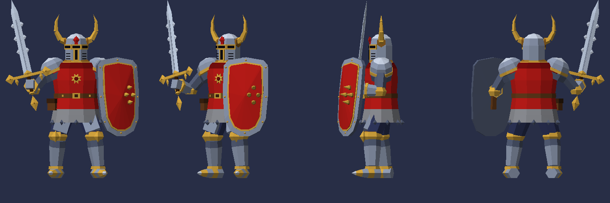
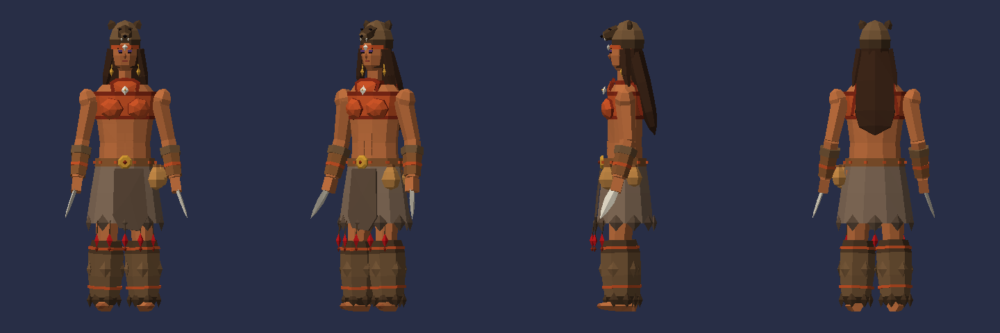

# Лоу-поли модели в стиле PS1

Персонажи в духе игр PlayStation 1: плоские грани, одна маленькая текстура-палитра
на модель, всё собирается скриптом на стандартном Python.

| Модель | Треугольников | Высота | Папка |
|---|---|---|---|
| Рыцарь с мечом и щитом: рогатый шлем, красная котта с солнцем, щит с шипами | 2 492 | 2,41 м с мечом | [`knight/`](knight) |
| Шаманка: медвежий капюшон, бисерный верх, набедренная повязка, меховые обмотки, костяные клинки | 2 916 | 1,92 м | [`shaman/`](shaman) |




Модели стоят ногами на нуле и смотрят в сторону +Z, единица — метр.
Палитра — текстура 64×64: клетка 8×8 на цвет, фильтрация «nearest».

## Файлы

В папке каждой модели:

| Файл | Что это |
|---|---|
| `<модель>.glb` | Для Blender, Godot, Unity, three.js. Палитра встроена в файл |
| `<модель>.obj`, `<модель>.mtl`, `palette.png` | То же самое в формате OBJ |
| `viewer.html` | Просмотрщик в духе PS1: 320×240, дрожание вершин, дизеринг, туман. Открывается в браузере без интернета (шрифты подгружаются, если сеть есть) |
| `preview.png` | Вид спереди, в три четверти, сбоку и сзади |

Исходники в корне папки:

| Файл | Что это |
|---|---|
| `knight.py`, `shaman.py` | Описание моделей: поза, пропорции, детали и палитра |
| `lowpoly.py` | Общие примитивы (призмы, конусы, тела вращения, ромбы, пластины) и экспорт |
| `build.py` | Пересборка моделей |
| `viewer_template.html` | Шаблон просмотрщика, в него сборка вставляет модель |

## Как поменять модель

Поправьте `knight.py` или `shaman.py` (цвета — в словаре `PALETTE`) и пересоберите:

```bash
python3 build.py
```

Собрать только одну модель:

```bash
python3 build.py shaman
```

Перекрасить готовую модель можно и без скрипта: откройте `palette.png` в любом
редакторе и залейте нужную клетку другим цветом.

## Импорт

- **Blender**: File → Import → glTF 2.0. Чтобы пиксели палитры не размывались,
  у Image Texture поставьте Interpolation: Closest (в glb это уже указано).
- **Godot 4**: перетащите `.glb` в проект; для PS1-вида включите в материале
  Texture Filter: Nearest.
- **Unity**: импортируйте `.glb` через glTFast или используйте `.obj`
  и выставьте у `palette.png` Filter Mode: Point.

Модели не заскинены (нет костей): это статичные фигуры в позе. Для анимации их нужно
привязать к скелету, например через Rigify или Mixamo.
